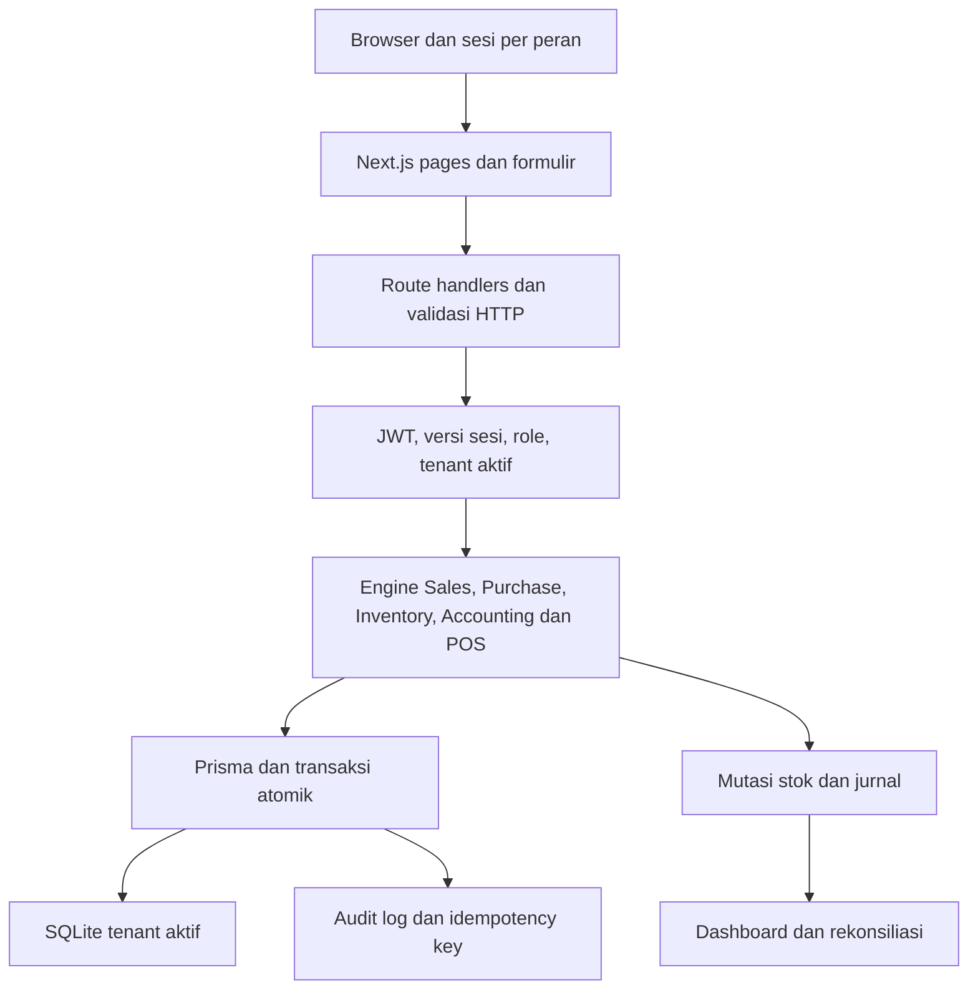
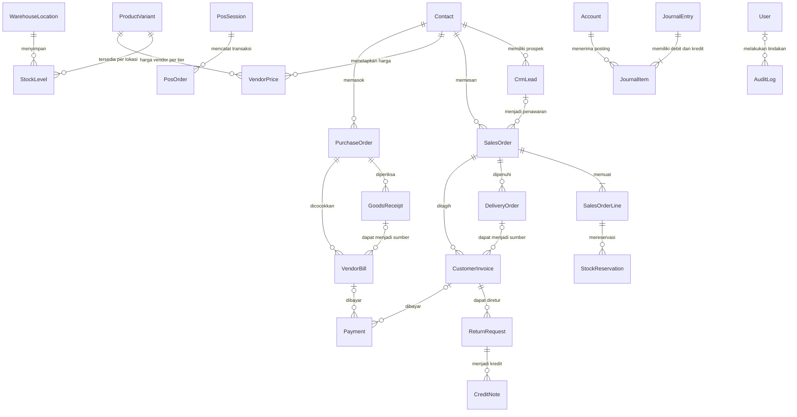

# Arsitektur ERP Rasa Aruna Kitchen

Aplikasi menggunakan Next.js App Router, React, TypeScript, Prisma, dan SQLite untuk operasi lokal. Setiap tenant lokal memakai file database terpisah. Profile demo dibuat dari schema dan fixture proyek pada folder mandiri dengan registri tenant sendiri.

JWT menyimpan identitas tenant dan versi sesi. Request memeriksa ulang status akun dan peran dari tenant aktif. Pergantian perusahaan menghapus sesi, lalu meminta login untuk perusahaan tujuan. Validator database memakai jalur tenant yang ditetapkan. Jika jalur tersebut hilang, operasi ditolak.

Engine menulis jurnal terposting dan mutasi stok dalam transaksi tenant yang sama. Nomor sumber pada `JournalEntry.sourceDocument` dan `StockMove.documentRef` menghubungkan posting ke dokumen. Sejumlah hubungan sumber adalah referensi nomor karena semua jenis transaksi berbagi jurnal atau tabel mutasi yang sama. `RequestIdentity` menyimpan hasil replay berdasarkan aktor, operasi, kunci, dan hash payload.

Diskon di atas 10% memerlukan keputusan Owner atas versi penawaran aktif. Keputusan disimpan di `AuditLog` dengan identitas, waktu, alasan, dan versi. Draft lama tanpa bukti Owner yang lengkap kembali menunggu keputusan. Dokumen yang sudah dikonfirmasi mempertahankan status serta audit historis.

Untuk Vercel, database harus persisten dan lintasan PostgreSQL harus diuji terhadap release yang akan dipromosikan. Lihat [kesiapan deployment](../reports/final-remediation/DEPLOYMENT_READINESS.md).
